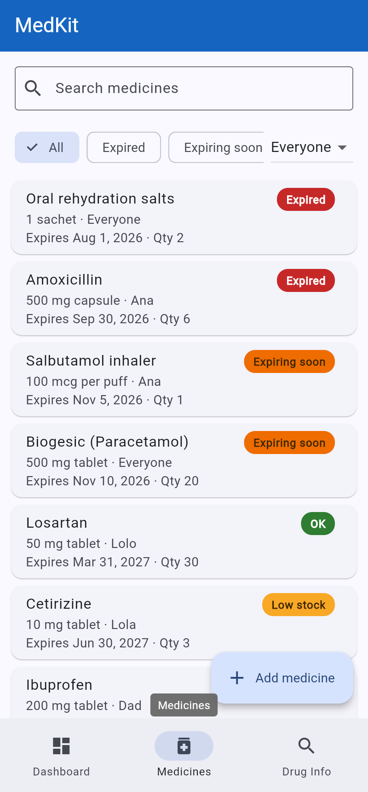
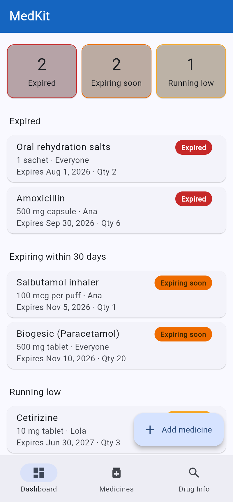
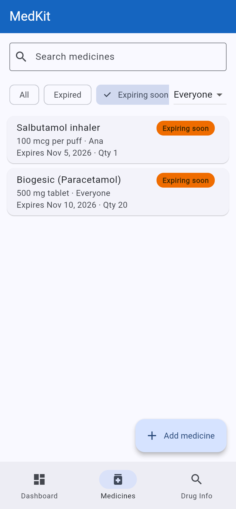
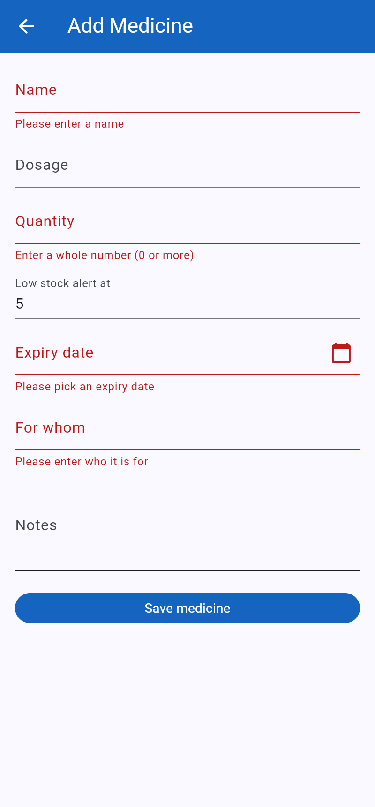
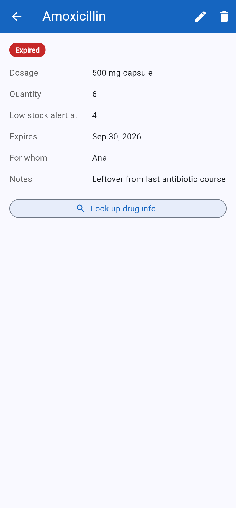
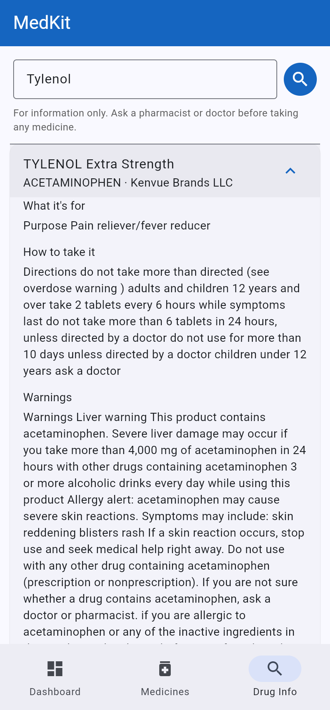
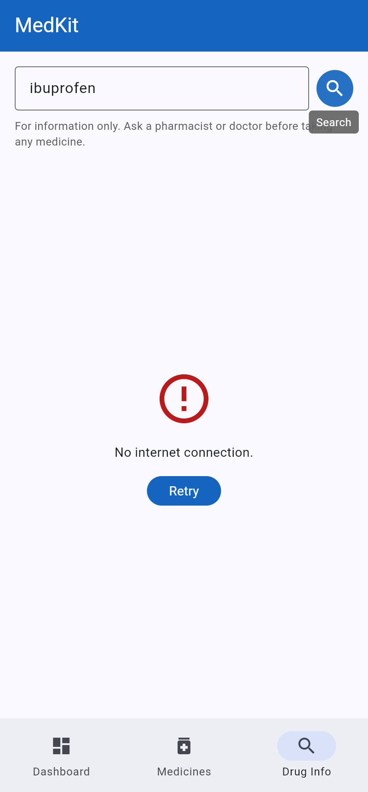
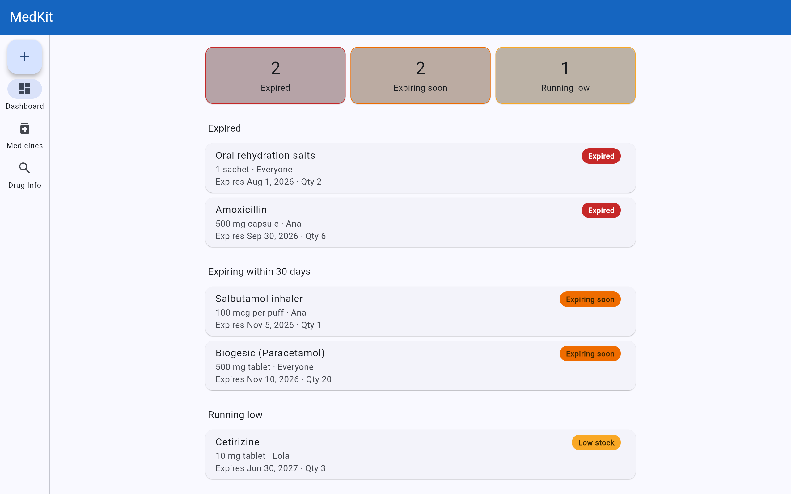
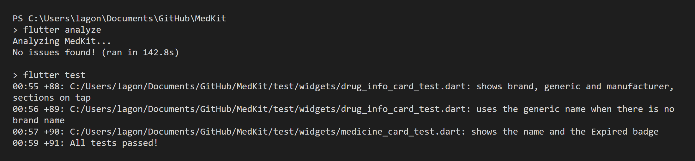

# MedKit

A home medicine cabinet tracker. Families list the medicines they have at home, and MedKit warns when one is expired, expiring soon or running low.

## Features

- Add, edit and delete medicines with expiry date, quantity and who they are for
- Dashboard of expired, expiring within 30 days and low stock medicines
- Search and filter the list by name, status and family member
- Look up a medicine's purpose, dosage and warnings from the openFDA drug label API
- Data is saved on the device

## Screenshots

| Medicines | Dashboard | Filters |
| --- | --- | --- |
|  |  |  |

| Add form | Detail | Drug info | Drug info error |
| --- | --- | --- | --- |
|  |  |  |  |

Wide window:



## Packages

- `provider` for state management
- `http` for the openFDA API
- `shared_preferences` for saving medicines on the device
- `intl` for date formatting
- `flutter_launcher_icons` and `flutter_native_splash` for the app icon and splash screen

## Setup

Requires Flutter 3.44 or newer.

```bash
git clone https://github.com/Nelsocated/MedKit.git
cd MedKit
flutter pub get
```

## Run

In Chrome (the fixed port keeps saved medicines between runs):

```bash
flutter run -d chrome --web-port 8080
```

On an Android device:

```bash
flutter run
```

## Build the APK

Needs the Android SDK (Android Studio or the command-line tools).

```bash
flutter build apk --release
```

The APK is saved to `build/app/outputs/flutter-apk/app-release.apk`. The release build is signed with the debug key.

## Tests

```bash
flutter analyze
flutter test
```

91 tests pass and `flutter analyze` finds no issues.

- Unit: medicine status rules, JSON for both models, `StorageService`, both providers, and `DrugInfoService` with mocked 200, 404, 429 and 500 responses
- Widget: form validation, list filters, detail screen, dashboard groups and route fallback



## Debugging case: brand names returned no results

**Bug:** Searching "ibuprofen" worked, but "Tylenol" never showed the Tylenol label.

**Found:** In Chrome DevTools, the request to api.fda.gov failed and the Network tab showed `%2B` between the two search terms. `%2B` is a literal `+`, which openFDA reads as AND, so it asked for labels whose brand and generic name were both "tylenol".

**Fix:** `Uri.https` encodes query values itself, so the literal `+` in `lib/services/drug_info_service.dart` was replaced with a space, which is sent as `+` (OR):

```dart
// before
'openfda.brand_name:"$cleanName"+openfda.generic_name:"$cleanName"'
// after
'openfda.brand_name:"$cleanName" openfda.generic_name:"$cleanName"'
```

Merged in pull request #23.

## Member

Nelson Lago III
